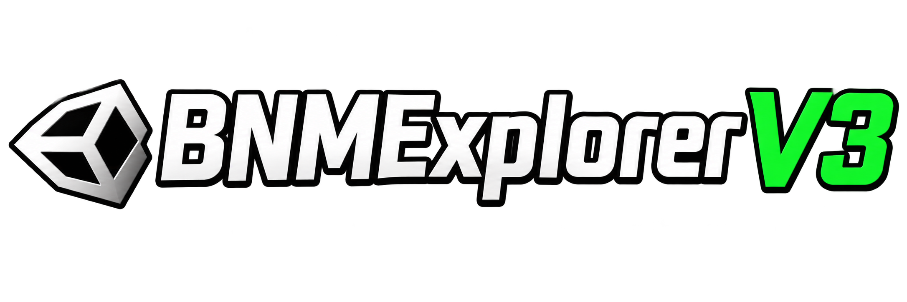
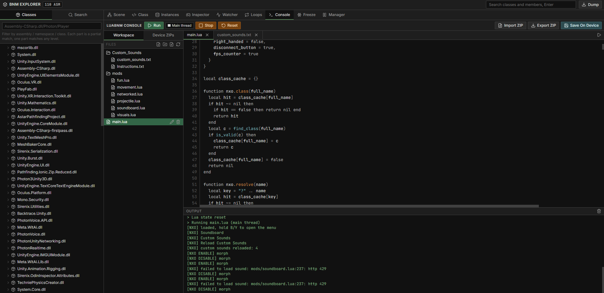

<meta property="og:title" content="BNM Explorer" />
<meta property="og:description" content="A web-based runtime inspector and debugger for IL2CPP Unity games on Android/VR/Mobile." />
<meta property="og:image" content="Uc5uSAT.png" />
<meta name="theme-color" content="#5865F2">

<div align="center">
  

  # BNM Explorer

  [](https://github.com/SilentErased/BNMExplorer/releases/latest)
  [](https://github.com/SilentErased/BNMExplorer/releases)
  [](https://github.com/SilentErased/BNMExplorer/blob/main/LICENSE)

</div>

<br>

A web-based runtime inspector and debugger for IL2CPP Unity games on Android/VR/Mobile. Runs an embedded HTTP server inside the game process, so you can explore and modify the game live from any browser.

<div align="center">
  
</div>

> [!WARNING]
> This tool is intended for **IL2CPP Unity games on Android**. The target game must be **patched with the native mod** before BNM Explorer can be used.

## Features

* **Web-Based UI**: Accessible from any web browser on your PC or phone. No heavy desktop client required.
* **Assembly Explorer**: Browse loaded assemblies, namespaces, classes, methods, and fields in a `dnSpy`-like interface.
* **Scene Hierarchy**: Real-time view of the Unity scene. Create, delete, and manage GameObjects dynamically.
* **Inspector**:
  * Edit `Transform` (Position, Rotation, Scale).
  * View and modify public/private fields and properties.
  * Supports `int`, `float`, `bool`, `string`, `Vector3`, `Color`, and more.
* **Method Invoker**: Call static or instance methods directly from the browser with custom arguments.
* **Instance Tracking**: Find live instances of any class in memory.
* **Component System**: Add or remove components at runtime.
* **Runtime Code Execution**: Run Lua code.

## Requirements

* Patch the target game and insert the native mod.
* Host machine and target device on the **same Wi-Fi network**.

## Getting Started

Download the [latest release](https://github.com/SilentErased/BNMExplorer/releases/latest), patch your game, then follow the steps below.

### 1. Identify the device IP

```bash
adb shell ip addr show wlan0
```

Locate the line starting with `inet` (e.g. `inet 192.168.1.101/24`).

> [!IMPORTANT]
> Make sure both your host machine and the target device are connected to the same Wi-Fi network.

### 2. Open the interface

Open your web browser and go to:

```
http://<DEVICE_IP>:8080
```

**Example:** `http://192.168.1.101:8080`

> [!TIP]
> On VR (standalone headset), just open `https://127.0.0.1:8080` in the headset's browser.

## License

BNM Explorer is licensed under the [LICENSE](LICENSE) file in this repository.